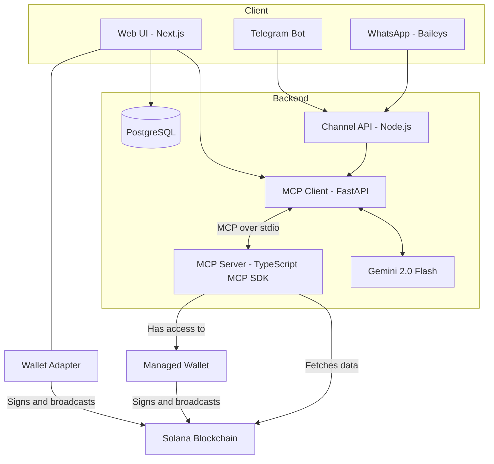

# HeySOL
 
**A chat-based gateway to the Solana blockchain.**
 
HeySOL lets you interact with Solana in plain English. Ask it to check a balance, fetch your NFTs or send SOL, and an LLM figures out what you mean, picks the right on-chain tool and runs it. You can use it from a web app, Telegram or WhatsApp.

 
## Features
 
- **Natural-language interface:** no commands or menus to memorize. Just describe what you want to do.
- **Multi-channel:** use the same assistant from the web app, Telegram or WhatsApp.
- **LLM-driven tool use:** Gemini handles intent detection, parameter extraction, tool selection and result summarization through the Model Context Protocol (MCP).
- **Two wallet modes:**
  - **Wallet Adapter mode:** connect your own wallet; transactions are signed by you and broadcast to Solana.
  - **Managed Wallet mode:** the server holds a wallet and signs and broadcasts on your behalf, which makes it usable from chat channels.
- **Extensible tools:** new on-chain actions are added as tools on the MCP server (for example `send_sol`, `get_nfts`).
## Architecture
 

 
### How it works
 
1. A user sends a message in natural language from the web app, Telegram or WhatsApp.
2. The **MCP client** (FastAPI) passes the message to **Gemini**, which extracts the intent and parameters and selects a tool.
3. The MCP client calls that tool on the **MCP server** over the MCP protocol (stdio).
4. The MCP server reads from or writes to the **Solana blockchain**.
   - **Wallet Adapter mode:** the transaction is returned to the web app, signed in the user's wallet and broadcast.
   - **Managed Wallet mode:** the MCP server signs and broadcasts using the managed wallet.
5. Gemini summarizes the result and the reply is sent back to the user in chat.
## Tech Stack
 
| Layer | Technology |
|---|---|
| Web app | Next.js, TypeScript |
| MCP client | Python, FastAPI |
| LLM | Google Gemini (`gemini-2.0-flash`) |
| MCP server | TypeScript, MCP SDK |
| Channel API | Node.js |
| Database | PostgreSQL, Prisma ORM |
| Channels | Next.js (web), Baileys (WhatsApp), Telegram Bot API |
| Blockchain | Solana |
| Tooling | Turborepo, pnpm workspaces, Docker |
 

 
## Usage
 
Try messages like these in the web app, Telegram or WhatsApp:
 
- "What's my SOL balance?"
- "Show me the NFTs in my wallet"
- "Send 0.1 SOL to `<wallet address>`"
In the web app, connect your wallet to use **Wallet Adapter mode**. On Telegram and WhatsApp, transactions use **Managed Wallet mode**.
 
## Security
 
- Transactions in Wallet Adapter mode are always signed by the user's own wallet.
- In Managed Wallet mode the server controls a private key. Keep it in environment secrets, never in the repo, and use small balances.

 
